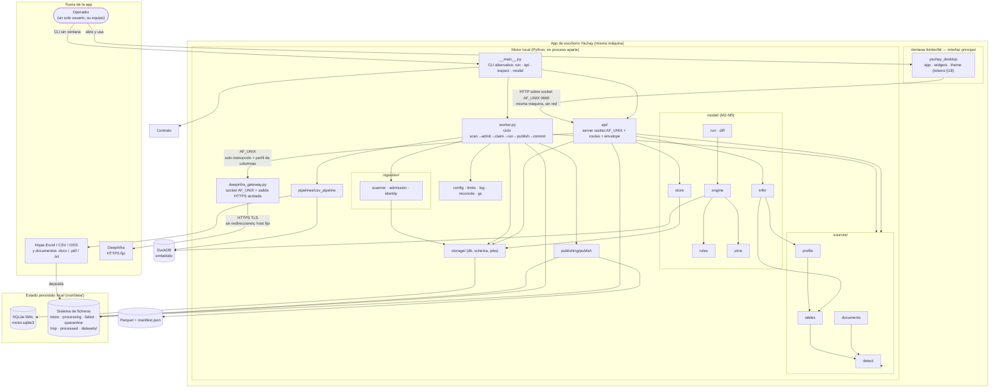
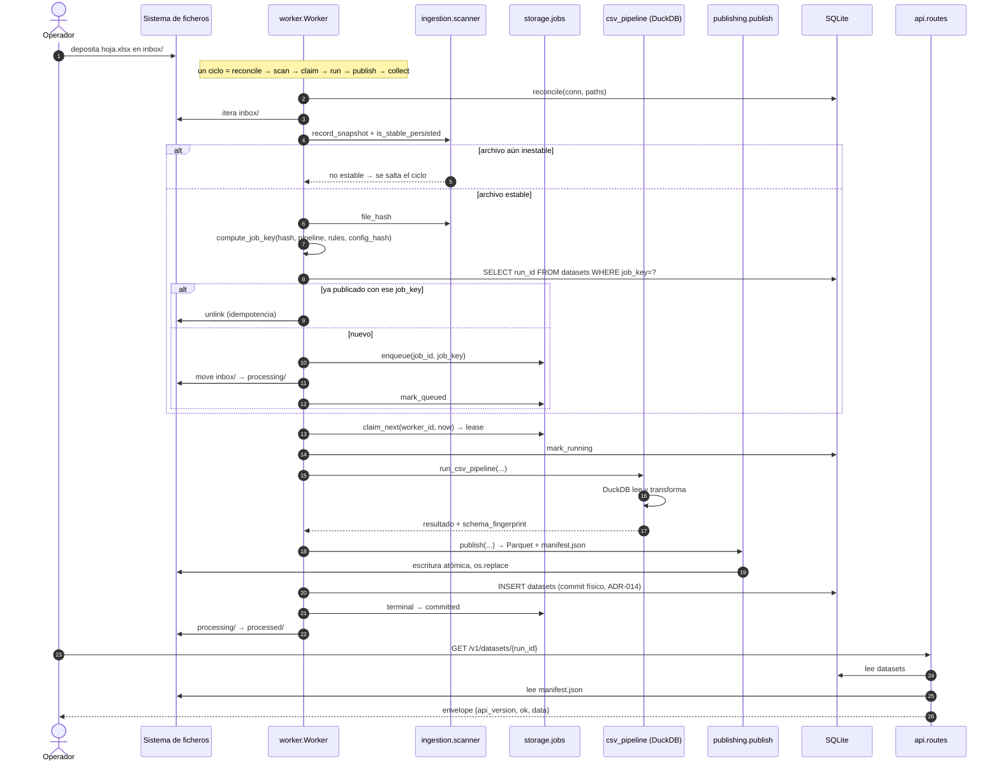
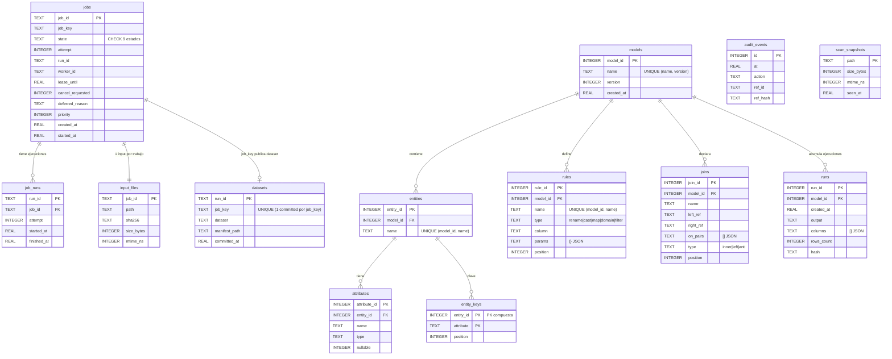
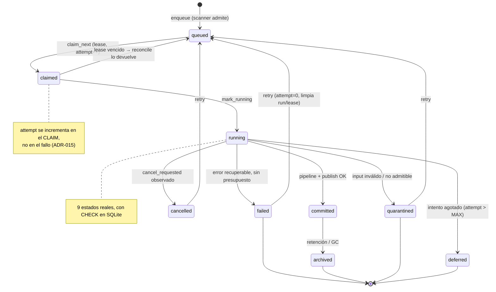
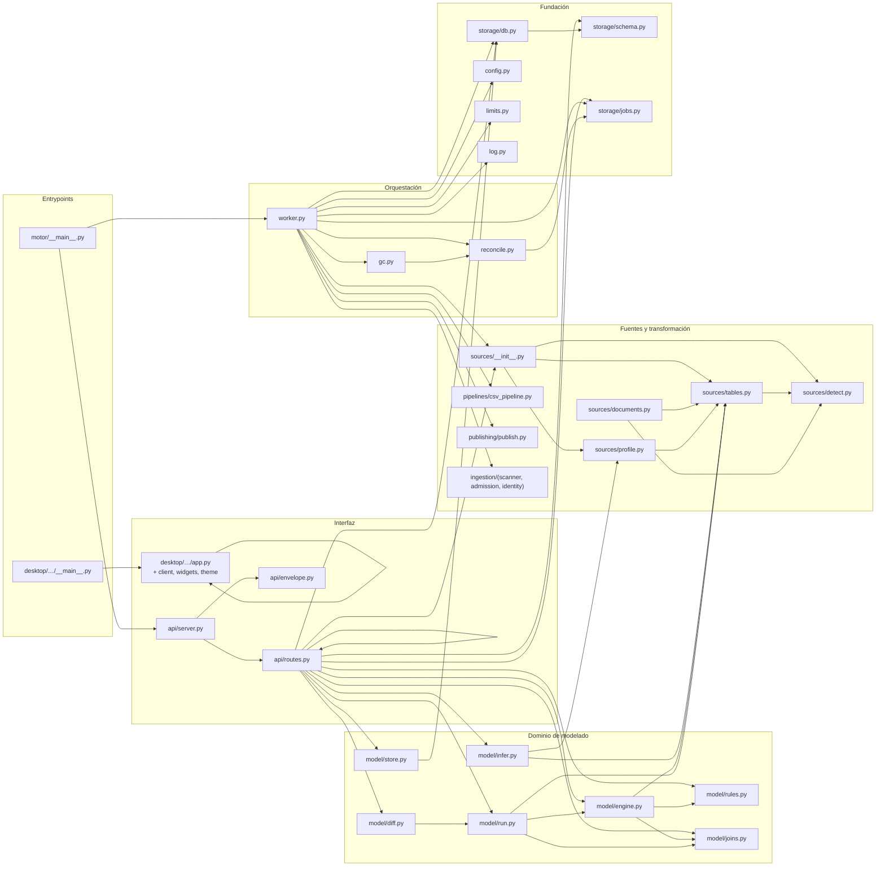

# Diagramas de arquitectura — Yachay motor de modelado

> **Qué es esto.** Una **app de escritorio** (tkinter/ttk) para uso frecuente de
> un solo operador en su propio equipo: el operador abre la ventana y el motor
> local queda detrás. La API sobre socket Unix **no es un servicio de red**: es
> el transporte local entre la ventana y el motor en la misma máquina
> (`AF_UNIX`, sin TCP; autenticación Bearer opcional — ADR-016). El CLI es la misma cosa sin
> ventana. Ver `ARQUITECTURA-MODELADO.md` §1: «desde una **app de escritorio**».
>
> Estado: **derivado del código** (no de la intención). Cada relación se verificó
> contra las fuentes primarias el 2026-11-12: `src/motor/**`, `desktop/yachay_desktop/**`,
> `src/motor/storage/schema.py`, `src/motor/api/routes.py` y `docs/api/openapi.yaml`.
>
> Notación: **Mermaid** como formato fuente (texto versionable, se renderiza en
> GitHub y en cualquier visor Markdown). No añade dependencias al proyecto
> (ADR-016). Fallback si hiciera falta imagen estática: exportar a SVG con
> `npx -y @mermaid-js/mermaid-cli`.
>
> Cuando un diagrama muestra algo inferido y no literal del código, se marca
> **(inferido)**. Todo lo demás tiene una línea de código detrás.

## Índice y elección de notación

| # | Pregunta que responde | Diagrama | Audiencia |
| --- | --- | --- | --- |
| 1 | ¿Qué piezas hay y de qué depende cada una en tiempo de ejecución? | Componentes (C4-nivel 2, UML-like) | Arquitecto, dev |
| 2 | ¿Cómo viaja un dato desde el disco hasta Parquet y vuelta a la app? | Secuencia | Dev, operador |
| 3 | ¿Qué tablas hay y cómo se relacionan en SQLite? | ERD | Dev, DBA |
| 4 | ¿Cómo se mueve un trabajo por los 9 estados? | Máquina de estados | Operador, dev |
| 5 | ¿Qué capas importan a qué capas? | Grafo de dependencias | Arquitecto |

Se usa **UML-like (C4, ERD, máquina de estados, grafo) y no UML formal** porque
la pregunta es de arquitectura de una aplicación concreta, no de intercambio de
modelos entre herramientas: no hay XMI, ni round-trip, ni auditoría de
conformidad UML. Mermaid comunica cada pregunta con menos ceremonia y queda
embebido en la documentación del repo.

---

## 1. Diagrama de componentes (C4 nivel 2)

La app de escritorio es la **interfaz principal**: el operador la abre, y detrás
vive el motor local servido por el socket Unix en el mismo equipo. El CLI es la
alternativa sin ventana para las mismas operaciones.



**Lectura.** Es **una app de escritorio local**, no un servicio web; la única
excepción de salida a Internet es el adaptador aislado para asistencia:

- **La ventana manda.** `yachay_desktop` (tkinter/ttk) es la interfaz que usa el
  operador a diario. El `worker` y la `api` corren en la misma máquina; la
  ventana se comunica con ellos por el socket Unix `data/motor.sock` (modo
  `0660`). API y worker no tienen red IP; `YACHAY_API_TOKEN` añade autenticación
  Bearer cuando se configura (ADR-016).
- **La asistencia sale por una frontera aparte.** `motor-deepinfra` corre con
  UID `yachay-net`, no acepta TCP y recibe propuestas por AF_UNIX. nftables
  restringe su salida a TCP/443 hacia las IP DNS refrescadas para DeepInfra; el
  proceso usa una lista corta con caducidad y no hace DNS. No puede leer
  `data/`; el API no posee la clave ni acceso de red.
- **Dos planos internos del motor**, separados por una frontera real:
  - El **plano de ingesta** (`worker.py` + `ingestion/` + `pipelines/` +
    `publishing/`) mueve bytes del disco a Parquet. No conoce el "modelo del
    usuario".
  - El **plano de modelado** (`model/`) implementa ADR-019: entidades, reglas y
    cruces sobre DuckDB, con su catálogo en SQLite.
- Comparten `storage/`, `sources/` y la misma base SQLite. La **UI no importa
  `motor`** (verificado: `desktop/` no tiene ningún `import motor`); por eso el
  motor puede estar en un proceso distinto sin que la ventana se acople a él.
- **M6 (entregada)**: la ventana incluye las vistas de carga/perfilado, modelo,
  ejecución y resultados, además de estado, cola y catálogo. El panel de estado
  resume las capacidades documentadas y cada vista conserva el contrato de la
  API v1; la UI no inventa operaciones que el motor no expone.

---

## 2. Secuencia — ingesta de una hoja hasta dataset publicado



**Notas de fidelidad.** El commit es por `job_key` (ADR-014) e idempotente: la
segunda subida del mismo contenido no crea un segundo dataset. El perfilado de
las hojas no vive aquí — `read_any`/`profile_table` se usan tanto por el CLI
`inspect` como por `POST /v1/models` (M1/M2); esta secuencia cubre la ruta
legacy de ingesta, que sigue vigente como capacidad.

---

## 3. ERD — esquema SQLite (`storage/schema.py`)



**Frontera explícita (ADR-005).** SQLite guarda **solo estado y metadatos**; los
datos tabulares viven en DuckDB y en Parquet. Por eso `runs.hash`/`runs.columns`
son huellas, no contenido. `audit_events` y `scan_snapshots` no tienen FK: son
registros append-only / snapshots por ruta.

**Puntos de integridad reales:**
- `datasets.job_key` es **UNIQUE**: máximo un dataset committed por `job_key`
  (ADR-014, commit idempotente).
- `entities`, `attributes`, `rules`, `joins`, `runs` tienen `ON DELETE CASCADE`
  desde `models`: borrar un modelo limpia su catálogo.
- `jobs.state` está acotado por `CHECK` a los 9 estados (ver §4).
- `schema_version` registra v1 (ingesta) → v2 (modelado) → v3 (ejecuciones).

---

## 4. Máquina de estados de `jobs`



**Matiz verificado.** `POST .../retry` acepta `failed|quarantined|cancelled`
(`docs/api/openapi.yaml`, `retryJob`) y deja `state='queued'`, `attempt=0`,
limpiando `run_id`, `worker_id`, `lease_until` y `cancel_requested`. El
incremento de `attempt` sucede en el claim (ADR-015).

---

## 5. Grafo de dependencias internas (capas)



**Regla de dirección.** El flujo es de un solo sentido: `Entrypoint → Interfaz →
Orquestación → Dominio → Fuentes → Fundación`. No hay dependencia de una capa
inferior hacia una superior.

**Riesgo de acoplamiento (no es un ciclo que falle).** Los `__init__.py` de
`model/` y `sources/` re-exportan sus submódulos, y algunos submódulos hacen
`from motor.model import …` / `from motor.sources import detect`. Hoy funciona
porque el `__init__` importa `detect` (y `diff`, `engine`, …) en orden
alfabético antes de que el submódulo lo necesite. Es una **cadena frágil**: una
renumeración de imports puede romper la carga. No hay ciclo de ejecución, pero
sí un acoplamiento bidireccional paquete↔submódulo que conviene documentar.

---

## Sustento y verificación

- Grafo de componentes, capas y dependencias: derivado de los `import` reales
  del árbol `src/motor/**` y `desktop/yachay_desktop/**`.
- ERD: copiado de `src/motor/storage/schema.py` (`_SCHEMA`, `_MODEL_SCHEMA`,
  `_SCHEMA_VERSION`).
- Estados: `JOB_STATES` en `schema.py`; transiciones de retry/lease desde
  `docs/api/openapi.yaml` y los ADR-014/015/017.
- Rutas de API: **9 estáticas + 15 dinámicas = 24 operaciones** en
  `src/motor/api/routes.py` (`_STATIC_ROUTES`, `_DYNAMIC_ROUTES`). El "17 rutas"
  de la documentación histórica corresponde a una versión intermedia; el contrato
  actual está en `docs/api/openapi.yaml`.

## Cómo re-renderizar

Los bloques son Mermaid válido. Para SVG/PNG estático:

```bash
npx -y @mermaid-js/mermaid-cli -i docs/modelado/DIAGRAMAS-ARQUITECTURA.md -o out/
```

Para mantenerlos vivos: cualquier PR que cambie `schema.py`, `routes.py` o los
`import` de `src/motor/**` debería actualizar el diagrama correspondiente. Si el
repo añade CI, un paso que compare estos diagramas contra el código (o al menos
que los valide como Mermaid sintácticamente correcto) cierra el bucle.
